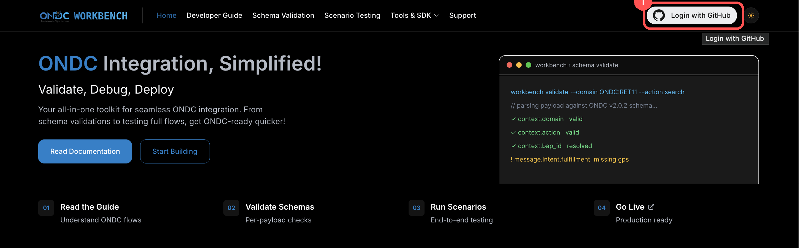
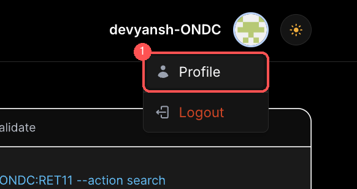
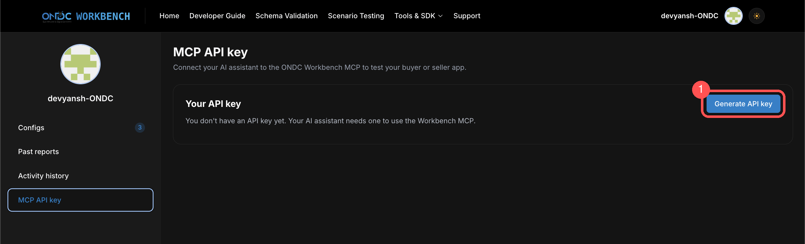
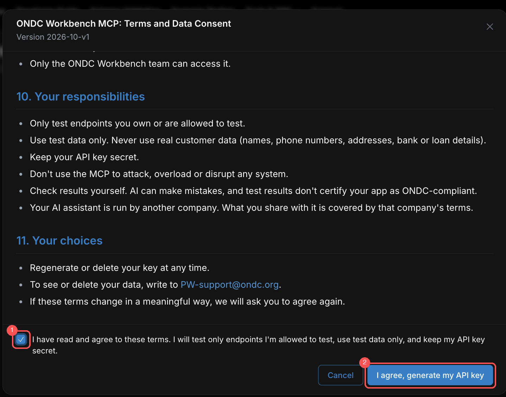
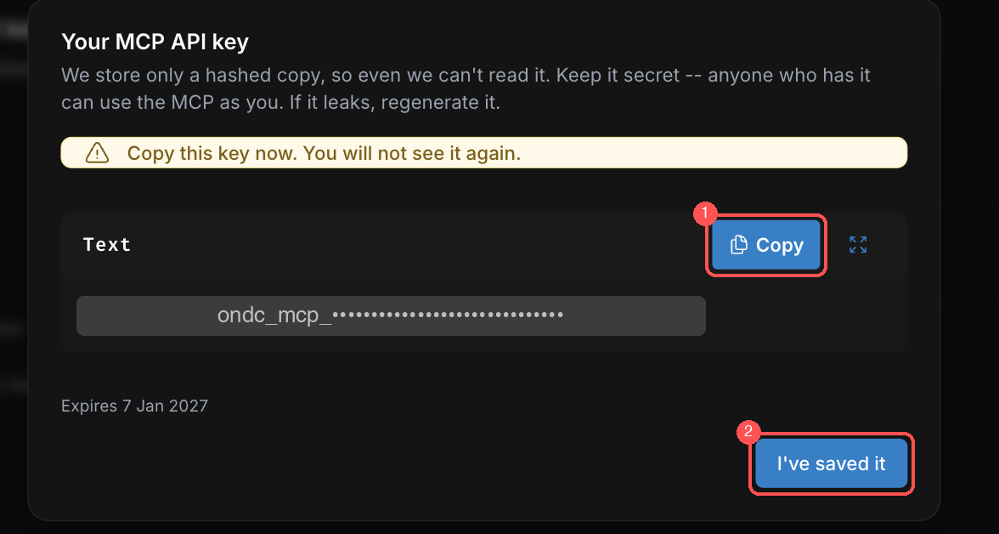
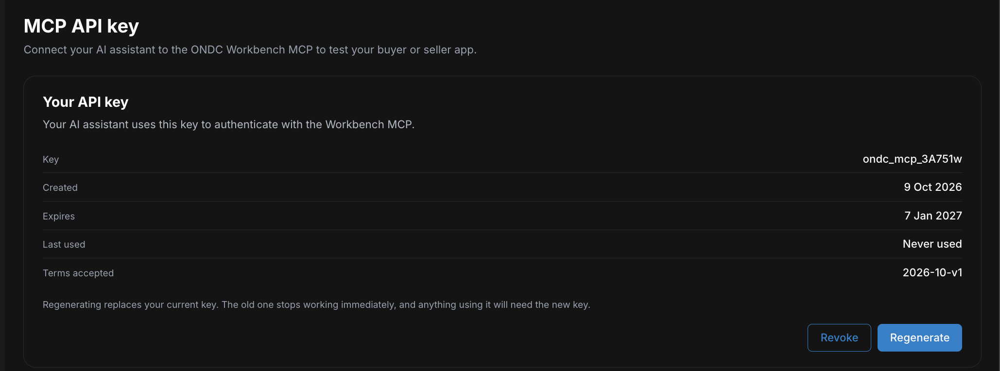
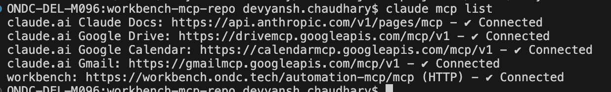
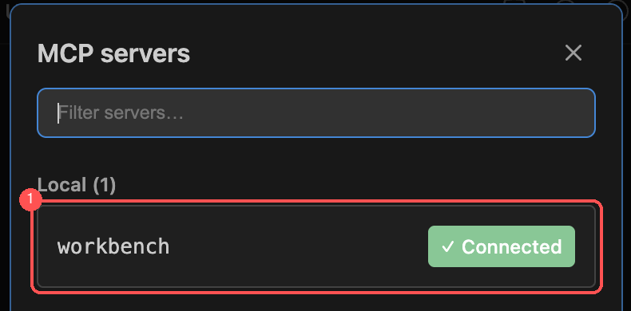

# Workbench MCP – Developer Setup Guide

This guide takes you from nothing to a working Workbench MCP in your AI tool.
It has two parts:

1. **Get your API key** from the Workbench website.
2. **Connect your tool.** Workbench MCP works with any AI tool that supports MCP, such as
   Claude, Cursor, Codex, Antigravity and more. Step-by-step examples are given for
   Claude Code and the Claude app, plus general settings for any other tool.

You only generate the key once. Every tool below uses the same key.

---

## What you need

- A GitHub account (Workbench uses GitHub login).
- Any AI tool that supports MCP (for example Claude, Cursor, Codex or Antigravity).

**MCP server URL** (used in every section below):

```
https://workbench.ondc.tech/automation-mcp/mcp
```

---

## Part 1 – Generate your API key

### Step 1. Log in with GitHub

Open [workbench.ondc.tech](https://workbench.ondc.tech) and click
**Login with GitHub** (top right). Approve the GitHub prompt.



### Step 2. Open your Profile

Once you are logged in, your GitHub name and avatar appear top right. Click them,
then choose **Profile**.



### Step 3. Click "Generate API key"

In your profile, open **MCP API key** in the left menu. If you have no key yet,
click **Generate API key**.



### Step 4. Agree to the terms

A **Terms and Data Consent** window opens. Read it, then:

1. Tick **I have read and agree to these terms**.
2. Click **I agree, generate my API key**.



### Step 5. Copy the key

Your key appears in a window. (It is hidden in the screenshot below. Yours will
show the full text, starting with `ondc_mcp_`.)

1. Click **Copy**.
2. Paste it somewhere safe, such as a password manager.
3. Click **I've saved it**.

> ⚠️ **The key is shown only once.** Workbench keeps only a scrambled (hashed)
> copy, so even the team cannot read it back. If you lose it, generate a new one.



### Step 6. Done

Back on the **MCP API key** page you can see the key's start, created date, expiry
date, when it was last used, and the terms version you accepted. From here you can
**Regenerate** (replaces the key) or **Revoke** (turns it off).



### Good to know about keys

| Topic | What happens |
| --- | --- |
| Lifetime | A key lasts **90 days**, then you generate a new one. |
| One key per person | Generating a new key **immediately stops the old one**. |
| Revoking | You can revoke your key from the same page at any time. |
| Sharing | Don't. Never commit it to Git or paste it in chat. |

---

## Part 2 – Connect your tool

In every example, replace `YOUR_KEY` with the key you copied
(it starts with `ondc_mcp_`).

### Option A – Claude Code (terminal and VS Code extension)

The terminal version and the VS Code extension share the same MCP setup. Add the server
once and both pick it up.

1. Open a terminal. In VS Code, use **Terminal → New Terminal**.
2. Run this once, replacing `YOUR_KEY` with your key:

```bash
claude mcp add --transport http workbench \
  https://workbench.ondc.tech/automation-mcp/mcp \
  --header "Authorization: Bearer YOUR_KEY"
```

3. Check that it connected:

```bash
claude mcp list
```

You should see `workbench ... ✔ Connected`.



4. Start `claude` in the terminal, or open the Claude Code panel in VS Code (start a new
   conversation if it was already open).
5. Type `/mcp`. `workbench` should be listed as connected.



> **Command not found?** The `claude` command comes from the Claude Code CLI. Install it
> first (see the Claude Code docs), then run the steps above.

### Option B – Claude app (desktop)

The desktop app's config file can't send a custom header to a remote server directly.
The simplest route is the `mcp-remote` bridge, which needs [Node.js](https://nodejs.org) installed.

1. Open the Claude app, then **Settings → Developer → Edit Config**.
   This opens `claude_desktop_config.json`.
2. Add the server:

```json
{
  "mcpServers": {
    "workbench": {
      "command": "npx",
      "args": [
        "-y",
        "mcp-remote",
        "https://workbench.ondc.tech/automation-mcp/mcp",
        "--header",
        "Authorization:${WORKBENCH_AUTH}"
      ],
      "env": {
        "WORKBENCH_AUTH": "Bearer YOUR_KEY"
      }
    }
  }
}
```

3. Save the file and **fully quit and reopen** the Claude app.
4. Open a new chat. The tools icon should list **workbench**.

> The value has no space after `Authorization:`. This avoids an argument-parsing
> problem on Windows. The space lives inside the `env` value instead.

### Option C – Any other AI tool (Cursor, Codex, Antigravity, and more)

Any tool that can connect to a remote MCP server works. Open that tool's MCP settings
(check its docs for where they live) and add a server with these values:

| Setting | Value |
| --- | --- |
| Name | `workbench` |
| Type / transport | HTTP (also called "streamable HTTP") |
| URL | `https://workbench.ondc.tech/automation-mcp/mcp` |
| Header | `Authorization: Bearer YOUR_KEY` |

---

## Check that it works

Ask your assistant something simple, for example:

> "List the Workbench tools you have available."

If it names the Workbench tools, you're done.

---

## Troubleshooting

| What you see | Why | Fix |
| --- | --- | --- |
| `401 Unauthorized` | Key is mistyped, revoked, expired, or replaced by a newer one | Generate a new key and update your config |
| `401` right away, no network delay | Key is the wrong shape | It must be `ondc_mcp_` followed by 43 characters. Copy it again without spaces |
| `503` / "try again" | Workbench couldn't be reached to check your key | Wait a moment and retry. Requests are never let through unchecked |
| Tool doesn't appear | Config not reloaded | Restart the tool (fully quit the app; reload the VS Code window) |
| Worked yesterday, fails today | Key hit its 90-day limit, or was regenerated on another machine | Generate a new key and update every tool that uses it |
| `404` or HTML page returned | URL is missing `/automation-mcp` | Use exactly `https://workbench.ondc.tech/automation-mcp/mcp` |

## Keep your key safe

- Don't commit it to Git. Keep it out of any file that is shared or checked in.
- Don't share it in screenshots, chats, or tickets.
- If it leaks, revoke it on Workbench and generate a new one.
